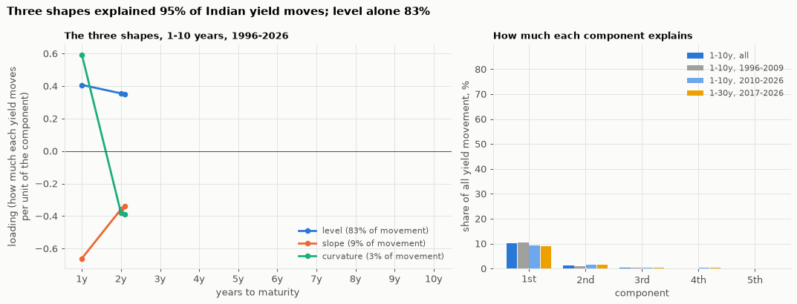
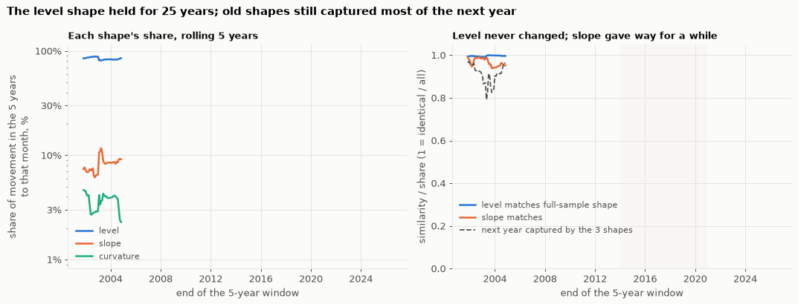
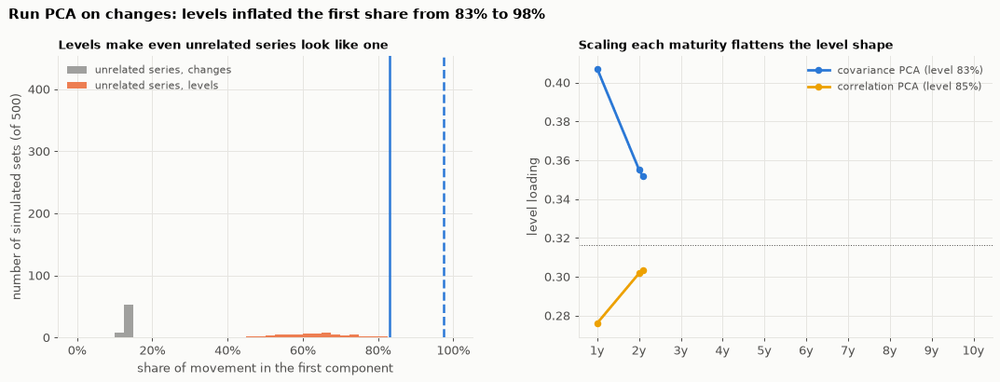

# Yield Curve PCA

[](https://github.com/Dhirajdas18/yield-curve-pca/actions/workflows/ci.yml)
[](https://dhirajdas18.github.io/yield-curve-pca/)

Principal component analysis of the Indian government bond yield curve from 1996 to 2026, on
RBI's month-end yields of Government of India dated securities from 1 to 30 years to maturity
(Handbook of Statistics on Indian Economy): the shapes the curve moves in, how stable they are,
hedging with them, what they predict, and how they compare with a Nelson-Siegel curve.

**Live PCA lab: [dhirajdas18.github.io/yield-curve-pca](https://dhirajdas18.github.io/yield-curve-pca/)**,
pick any years and maturities and see the level, slope and curvature shapes, how much of the
curve's movement each explains, and each one's path over time, computed in your browser.

## Features

- [x] PCA of monthly yield changes: level, slope and curvature, and how much each explains
- [x] Stability of the shapes over time: rolling PCA through rate cycles
- [x] Changes against levels, and how the maturities chosen change the answer
- [ ] Hedging a bond portfolio with the components, against duration alone, out of sample
- [ ] Does the curve predict? Slope and curvature against future rate changes, out of sample
- [ ] PCA against Nelson-Siegel: fit and stability
- [ ] Verdict: a curve-risk model and a regime input for the reference model

## Findings

### 1. Three shapes explained 95% of Indian yield moves; level alone 83%

<a href="docs/img/pca.png"><picture><source media="(prefers-reduced-motion: reduce)" srcset="docs/img/pca.png"></picture></a>

RBI's month-end yields from settled (SGL) trades in Government of India dated securities, merged
from the Handbook editions since 2008 with the newest edition preferred; every month from April
1996 to June 2026 is covered. PCA is the eigen-decomposition of the covariance of monthly yield
changes in basis points, over the longest run of consecutive months with every chosen maturity:
1 to 10 years from November 1996 (356 changes), and 1, 2, 3, 5, 7, 10, 15, 20, 25 and 30 years
from December 2017 (103), when 30-year yields become complete. Signs are fixed so level loads
positively, slope rises with maturity and curvature dips in the middle. Nothing is forecast, so
nothing is out of sample here.

- **Level explained 83%.** On 1–10 years the first component explained 83.0% of monthly yield
  movement, the second (slope) 9.2% and the third (curvature) 3.3%: 95.4% together.
- **Short yields moved most.** The 1-year yield moved 47 bp a month (standard deviation) against
  30–33 bp from 3 to 10 years, so the level component leaned towards the short end (loading 0.41 at
  1 year against 0.28 at 10).
- **Three components rebuilt most months closely.** The error left after three components was 7.2
  bp a month (root mean square) against 33.9 bp of raw moves; the largest single miss was 81 bp.
- **Level mattered less after 2010.** Its share was 85.6% in 1996–2009 and 76.0% in 2010–2026, with
  slope rising from 8.3% to 11.9%.
- **On 1–30 years the third component was mostly the 10-year yield on its own.** Level 73.9%, slope
  13.0%, then 3.7% for a component loading −0.86 on the 10-year yield and under 0.3 on every other
  maturity.

### 2. The level shape held for 25 years; old shapes still captured most of the next year

<a href="docs/img/stability.png"><picture><source media="(prefers-reduced-motion: reduce)" srcset="docs/img/stability.png"></picture></a>

Finding 1's 1–10 year monthly changes, with PCA rerun on every 60-month window (297 windows ending
October 2001 to June 2026). Each window's components are compared with the full-sample ones by the
absolute cosine of their loadings (1 = the same shape), and the three-shape set by its overlap with
the full-sample set (the mean squared cosine, which ignores order and sign). Out of sample, each
window's three shapes are applied to the next 12 months, with nothing refitted: the share of those
months' movement they capture, against the most any three shapes could capture (those months' own
first three, an in-sample ceiling) and a parallel shift of the whole curve alone. The 10-year
yield's kink is its distance from the average of the 9- and 11-year yields.

- **Level never changed shape.** Every window's level matched the full-sample level with a cosine of
  0.96 or more (median 0.99); its share ranged from 70.7% to 92.2% (median 81.3%).
- **Past shapes captured most of the next year.** Each window's three shapes captured a median 92.7%
  of the next 12 months' movement, against a ceiling of 96.7% and 75.6% for a parallel shift alone;
  the worst year was 50.5%.
- **Slope gave way to the 10-year yield for a while.** In windows ending from late 2017 to 2021 the
  second component was the 10-year yield moving on its own (loading +0.90 at 10 years, 0.25 or less
  elsewhere, in the window to December 2018), and slope's match fell as low as 0.16 (October 2018).
  The 10-year kink moved 20.3 bp a month in 2014–2020 against 6.7 bp in other years, with jumps of
  +68 bp (April 2016), +59 bp (December 2016) and −59 bp (May 2020).
- **Curvature was the least stable.** Its match with the full-sample shape was below 0.9 in 66% of
  windows (median 0.85), and its share ran from 1.0% to 7.4%.

### 3. Run PCA on changes: levels inflated the first share from 83% to 98%

<a href="docs/img/levels.png"><picture><source media="(prefers-reduced-motion: reduce)" srcset="docs/img/levels.png"></picture></a>

Finding 1's 1–10 year yields, PCA run on month-end levels (357 months, October 1996 to June 2026)
and on monthly changes over the same months (356). To see what levels do on their own, PCA is also
run on 500 sets of 10 independent random walks of the same length (seed 0): series with nothing in
common, on their levels and on their steps. Then two choices on changes: correlation PCA (each
maturity scaled to the same volatility) against covariance PCA, and different maturity sets.

- **Levels made one shape look almost everything.** On levels the first component explained 97.5%,
  on changes 83.0%; slope fell from 9.2% to 2.1% and curvature from 3.3% to 0.2%. Yield levels
  barely change from one month to the next (lag-one autocorrelation 0.968–0.987); changes don't
  carry over (−0.04 to +0.07).
- **Unrelated series did the same.** On the levels of independent random walks the first component
  explained a median 63.6% (5–95%: 45.6–79.0%); on their steps, 12.9%, close to one tenth, as it
  should be.
- **The shapes themselves agreed.** Levels and changes gave nearly the same loadings: cosine 0.99
  for level and slope, 0.93 for curvature.
- **Scaling each maturity flattened the level shape.** Correlation PCA gave level 84.8% with
  loadings of 0.28–0.33 across maturities (peaking at 5–7 years), against covariance PCA's 0.41 at
  1 year falling to 0.28 at 10.
- **The 1-year yield carried a lot of the slope and curvature.** Without it, level rose to 86.7%,
  slope fell to 7.4% and curvature to 2.0%; with only 1, 2, 5 and 10 years the shares barely moved
  (83.4%, 10.2%, 4.2%).

## Quick start

```bash
uv sync
uv run python scripts/fetch_data.py   # RBI Handbook tables -> data/rbi/yields.parquet
uv run yc report pca                  # topics: pca, stability, levels
uv run python scripts/build_site.py   # PCA lab -> site/index.html
uv run pytest
```

The yields are downloaded from rbi.org.in, not committed.

## Design

- `src/yc/data.py`: fetches every Handbook edition's table of month-end SGL yields by maturity,
  parses it, merges editions (newest wins) and refuses a history with a missing month.
- `src/yc/pca.py`: PCA of yield moves with fixed signs for level, slope and curvature, the share
  of movement a set of shapes captures, and rolling windows scored on the following months.
- `src/yc/yc.js`: the lab's browser copy of the PCA (Jacobi eigen-decomposition), tested against
  Python through Node.
- `src/yc/site.py`: the PCA lab, one static Plotly page carrying the monthly yields.
- `src/yc/reports.py`: README findings, reproducible with `yc report <topic>`.
- Conventions: yields in percent, changes in basis points, month-end to month-end; PCA on the
  covariance (not correlation) of the chosen maturities.
- Data: Reserve Bank of India, Handbook of Statistics on Indian Economy, "Month-end Yield of SGL
  Transactions in Government Dated Securities for Various Maturities" (earlier editions: "Yield of
  SGL Transactions in Government Dated Securities for Various Maturities").
- Charts: one validated palette; README charts are animated GIFs with a static fallback for
  reduced-motion users.

Research only, not investment advice. MIT licence.
